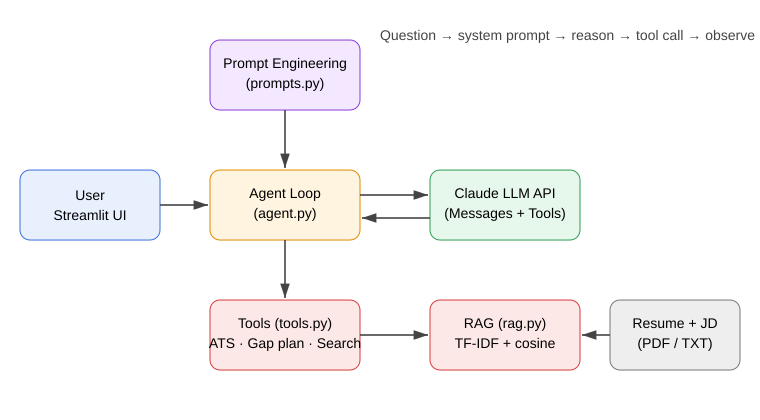
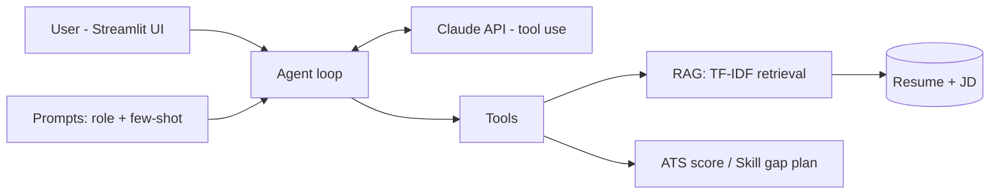

# Architecture

**Flow:** the UI sends chat history + mode prompt to the agent. The agent calls Claude with tool
schemas; when Claude requests a tool, we run it (RAG search, ATS scoring, gap planning), feed the
result back, and loop until Claude returns the final answer (max 6 steps).
